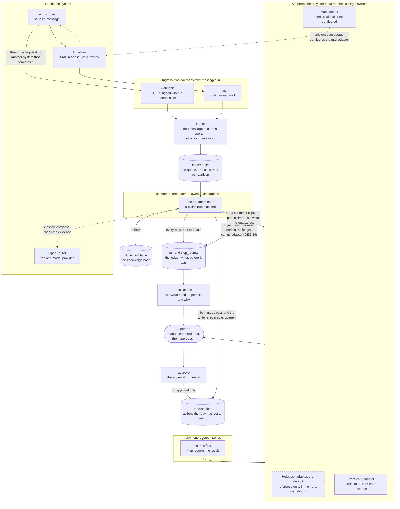
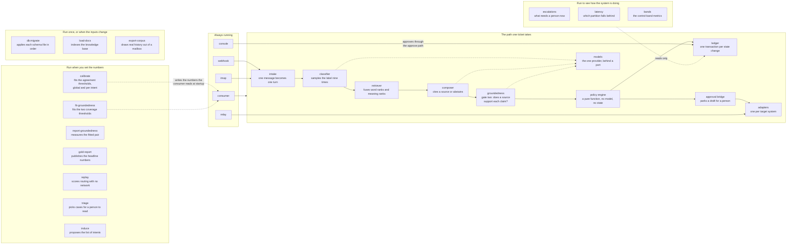
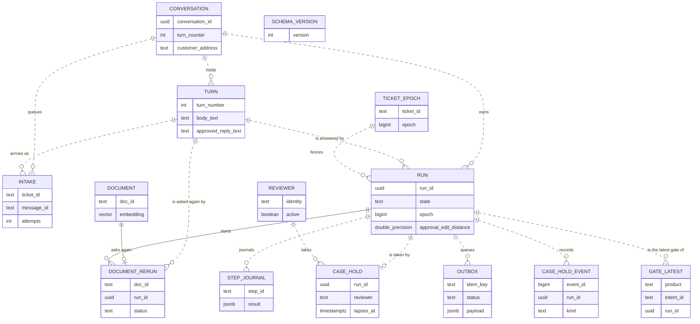

# Architecture map

This document draws the system. `docs/v1-architecture.md` decides it, and this
map never overrules that register. Read the register for a decision. Read this
map for a picture.

Each diagram has a legend below it. The legend names every box, so a reader who
writes no code can still follow the drawing.

Where the register's appendix names a thing, this map uses that name. One name
has one meaning, so this document introduces no friendlier word for a thing the
register already names.

`scripts/check-docs.py` reads this file. It proves that each diagram declares
every box it draws an edge to. It also proves that every box has a legend
row. And it proves that parts of three rules in section 1 survive an edit.

The checker decides structure and reference. It does not decide whether a
diagram is true. A database test checks the entity diagram against the
migrated ledger, as section 3 says. A reader checks the other two.

## 1. One message, end to end

The drawing below follows one customer message from arrival to reply.

Four parts of it are easy to get wrong:

1. A customer reply that waits for approval queues nothing to send. The draft
   goes to the adapter, and a person acts there.
2. The draft never travels from the coordinator to a person directly.
3. The path back to the customer needs a configuration choice. The map draws
   it with a broken line.
4. A gated internal write parks in the ledger and calls no adapter (DEC-34).
   A person finds it through the escalations report.

The checker holds the second sentence of rule 1, and it holds rules 2 and 3.
It cannot hold the first sentence of rule 1, and it cannot hold rule 4. Both
ask what an edge means, and only a reader decides that.

| Name | What it means |
|---|---|
| EXT | Everything the system does not run. |
| CUST | The person who writes to support. |
| LLM | The one model provider. Every model call leaves through it. |
| MAILBOX | An email account. The system reads it and can write to it. |
| INGRESS | The two ways a message arrives. |
| WH | A daemon. It accepts an HTTP request from another system. It checks the signature when an adopter sets a secret, and accepts every caller when nobody does. |
| IMAPD | A daemon. It polls the mailbox for unread mail. |
| ENQ | The step that turns one arriving message into one queue row. |
| Q | The queue. A partition is a group of conversations one consumer owns. |
| CONS | The daemon that does the work. One consumer owns each partition. |
| SM | The run coordinator. It walks each run through fixed steps. |
| KB | The stored answers the system may cite. |
| LGR | The tables that hold all state. The system writes here before it acts. |
| ESCQ | A read-only report. It lists the runs that need a person, with the reason. |
| OBX | The table that holds actions the relay has yet to send. |
| ADAPT | The components that connect the system to one external system. |
| HD | The reference helpdesk adapter. It holds fixtures and reaches no network. |
| SMTP | The mail adapter. An adopter chooses it, and then real mail leaves. |
| FS | The FreeScout adapter. An adopter chooses it, and it posts through the FreeScout API. |
| PERSON | A reviewer. For a customer reply they read the draft in the helpdesk or the operator console. |
| APPR | The command a reviewer runs to approve one parked action. |
| RELAYD | The daemon that drains the outbox. |
| RL | It sends the action, and only then records that it sent. |

Read the two arrows into the outbox together. A reversible internal write goes
automatically. A customer reply does not, so it waits (DEC-12).

Two kinds of work wait for a person, and they wait in different places. A
customer reply parks as a draft in the adapter. The reviewer opens it in the
helpdesk or the operator console (DEC-11, DEC-40, DEC-44). A gated internal
write has nothing to park there, so it parks in the ledger and calls no
adapter (DEC-34). The escalations report is how a person finds that second
kind.

The order inside the relay matters. A status written before the send turns a
crash into an action that looks sent and never was.

## 2. What lives in the source tree

The drawing below groups the code by when it runs. That is a reader's first
question, because a daemon and an offline job fail in different ways.

| Name | What it means |
|---|---|
| DAEMONS | The processes that run without stopping. |
| WEBHOOKD | Accepts messages over HTTP. It checks the signature only when an adopter sets a secret. |
| IMAPPOLL | Accepts messages from a mailbox. |
| CONSUMERD | Walks each run through the steps. |
| RELAYD2 | Sends the actions the outbox holds. |
| CONSOLED | Serves the operator console, where a reviewer approves, closes, sends back or snoozes a parked action. It approves through the same path as the approve command. |
| RUNTIME | The components that handle one ticket. The consumer calls all but the first. |
| ENQ2 | Turns one arriving message into one queue row, and routes it to its conversation. |
| CLASSIFY | Picks the intent. It samples nine times, so disagreement is visible. |
| RETRIEVE | Finds the stored text that could answer the ticket. |
| COMPOSE | Writes the answer with citations, or says it cannot. |
| GROUND | Tests each claim against the retrieved text. This is the second gate. |
| POLICY | Applies the gates and the risk tier of the intent. It calls no model. |
| LEDGER | The Postgres tables that hold all state. It calls no adapter. |
| BRIDGE2 | Puts a customer reply in front of a person as a draft. It calls the adapter. |
| ADAPTERS2 | The code that talks to a helpdesk or a mail server. The drawing shows two callers. The approve command and the imap daemon call it too. |
| MODELS2 | The model port, and the one provider behind it. |
| FITTING | Offline jobs that fit, measure or select. None touches live traffic. |
| CALIBRATE | Chooses the thresholds the first gate compares against: one global, and one for each intent with enough cases. |
| FITGROUND | Chooses the two thresholds the second gate compares against. |
| REPORTGROUND | Measures those two thresholds on cases that chose nothing. |
| GOLDREPORT | Produces the numbers the README publishes. |
| REPLAY | Replays labeled cases with no network and no database. |
| TRIAGE | Selects cases for review. It never gives a published number. |
| INDUCE | Groups past tickets and proposes a name for each group. |
| WATCH | Reports that read the ledger and write nothing to it. |
| ESCALATIONS | Lists the runs that need a person, with the reason. |
| LATENCY | Reports queue wait and service time for each partition. |
| BANDS | Reports the control-band metrics for one day. |
| SETUP | Jobs an operator runs before or between runs. |
| MIGRATE | Applies each schema file in order and records the version. |
| LOADDOCS | Reads a directory of documents into the knowledge base. |
| EXPORT | Pulls real conversations out of a mailbox. That output never enters the repository. |

The two gates stay apart on purpose (DEC-05). One catches a classifier that
answers inconsistently. The other catches an answer that no source supports. A
single blended score can pass while one of them has failed.

## 3. The stored state

The drawing below shows every table and how they join. A solid line is a
foreign key, and a broken line is a join only the code makes. The paragraph
under the drawing names the foreign keys.

| Name | What it means |
|---|---|
| CONVERSATION | One exchange with one customer. It counts the turns it holds. |
| TURN | One message in a conversation, and the reply a person approves for it. |
| INTAKE | The queue. One row waits for a consumer to pick it up. |
| RUN | One pass of the coordinator over one turn, or over a ticket that has no conversation. |
| TICKET_EPOCH | The highest fencing epoch a ticket accepts. It stops a stale writer. |
| STEP_JOURNAL | One row for each step. The system writes here before it acts. |
| OUTBOX | One row for each action the relay has yet to send. |
| DOCUMENT | The knowledge base. The retriever searches it by words and by meaning. |
| SCHEMA_VERSION | Each migration the runner applies. `src/ledger/migrate.ts` creates this one. |
| REVIEWER | The roster of people the console serves. |
| CASE_HOLD | The reviewer who holds the reservation of a parked run now, and when the reservation lapses. |
| CASE_HOLD_EVENT | Each take, handover, release, send, close, send-back and lapse of a reservation. |
| DOCUMENT_RERUN | A document a reviewer writes from a case, and the new attempt it asks for. |
| GATE_LATEST | The most recent gate reading for each product and intent. |

**The solid lines are foreign keys.** A solid line is one the database enforces.
`DOCUMENT_RERUN` declares a foreign key to `DOCUMENT` and one to `RUN`. Every
other table declares no foreign key. So every broken line is a join the
application makes and the database does not enforce. Delete a conversation
row and no row disappears with it.

`src/db/architecture-map.db.test.ts` compares this drawing with the migrated
ledger. A table the drawing leaves out, or a foreign key it draws as a broken
line, fails the test.

Read `TICKET_EPOCH` beside `RUN`. The epoch is a number that increases. It
makes a write from an old owner fail rather than corrupt the state.

## Where to go next

- [The decision register](v1-architecture.md) holds the decisions. It is the only design authority.
- [The runbook](operations.md) tells an operator what to run.
- [The V2 roadmap](v2-roadmap.md) says what is left and what blocks it.
- [The contributing guide](../CONTRIBUTING.md) takes you from a checkout to a merged change.
- [The README](../README.md) states the published numbers and the compliance position.
